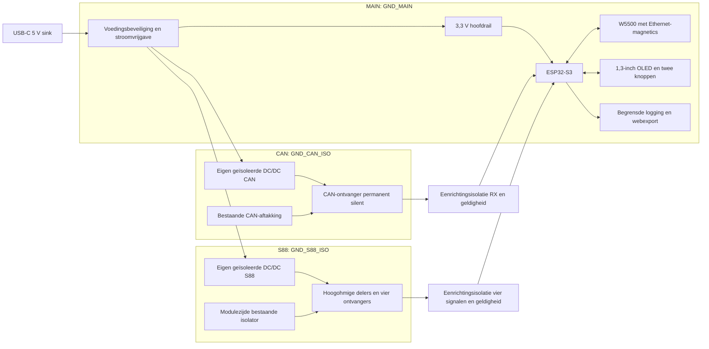

# Voorlopige hardwarearchitectuur

Status: **O**. Dit document legt functies en elektrische grenzen vast,
geen definitief schema of connectorontwerp. Verwijzingen [Sxx] staan in
het [bronnenregister](06-bronnenregister.md).

## 1. Drie elektrische domeinen

De getekende DC/DC-blokken én digitale isolatoren vormen gezamenlijk
de barrières. Voedingspijlen over een barrière zijn geïsoleerde overdracht,
geen gezamenlijke massa.

| Domein | Referentie | Toegestane verbindingen buiten het domein |
| --- | --- | --- |
| MAIN | USB-/logica-GND | USB-voeding, gebruikersinterface, lokale debug, Ethernet via magnetics |
| CAN | Alleen de geverifieerde CAN-signaalreferentie | CANH/CANL en CAN-referentie via vrijgegeven aftakking |
| S88 | Alleen modulezijdige S88-GND | CLOCK/LOAD/RESET/DATA en hoogohmige voedingsreferentie op modulebus |

CAN-GND en S88-GND worden **in de analyzer niet verbonden**. Dat ze
extern mogelijk hetzelfde potentiaal hebben, is geen reden om de
bestaande isolator te overbruggen. GND_MAIN mag via USB/debug geaard zijn;
de scheiding moet ook dan intact blijven. Geen gedeelde secundaire
voeding voor CAN en S88.

De vier S88-kanalen delen één S88-referentie. Dat is isolatie tussen bus
en hoofdelektronica, geen onderlinge kanaalisolatie. Er wordt niet tegelijk
aan beide zijden van de bestaande isolator gemeten.

## 2. CAN: drie onafhankelijke beperkingen

Kandidaat: TJA1051T/3 met geïsoleerde 5 V en lokale 3,3 V VIO [S09].

1. **Hardware-silent:** S blijft lokaal HIGH, zonder MCU-pad of
   programmeerbare jumper. De ontvanger blijft actief.
2. **TXD recessief:** TXD wordt afzonderlijk lokaal HIGH vastgelegd.
   Er bestaat geen TX-signaal of terugwaarts digitaal isolatiekanaal.
3. **Controller listen-only:** de latere TWAI-configuratie onderdrukt ook
   ACK/errorframes. Een door de driver vereiste TX-GPIO blijft elektrisch
   onverbonden; de exacte driverconfiguratie wordt later gecontroleerd.

S en TXD moeten hun geldige niveaus ook tijdens opstarten en deelvoeding
houden. Vertrouw hiervoor niet op interne pulldowns. De voeding en
vastlegging worden pas in het schema gedimensioneerd.

Een kanaal voor RXD loopt uitsluitend richting MCU. Bij verlies van de
CAN-frontvoeding moet dit kanaal recessief HIGH worden. Een tweede
eenrichtingskanaal draagt `CAN_VALID_N`: HIGH betekent ongeldig en is ook
de gewenste verliesstand. De geldigheidslogica moet zowel de lokale 5 V
als VIO bewaken. Een recessief signaal alleen bewijst geen werkende ingang.

Er komt geen 120 Ω, terminatiejumper, split termination of softwarematig
inschakelbare afsluiting. Ook geen “autodetectie” door proeftransmissies.

De ingang is elektrisch eindig belastend. [S09] geeft minimaal 19 kΩ
differentiële ingangsweerstand onder de opgegeven condities. **O-berekening:**
60 Ω parallel 19 kΩ is ongeveer 59,81 Ω, circa 0,32% verschil. Dit houdt
nog geen rekening met bescherming, kabel, common-mode of de echte bus.
Het S88-doel van 1 MΩ wordt dus niet voor deze CAN-transceiver geclaimd.

**Open dimensionering:** per CAN-lijn seriestroombegrenzing nabij de
aftakking, gevolgd door geschikte bescherming naar uitsluitend CAN-GND.
Controleer ontvangstdrempel, RC-vertraging, foutstroom en dissipatie samen.
Een TVS-kortsluiting mag niet onbegrensd op de hoofdbus terechtkomen.
Er zijn hier nog geen weerstand- of TVS-waarden vrijgegeven.

Een kortsluiting aan een connector vóór stroombegrenzing kan de bus
nog steeds verstoren. “Uitsluitend ontvangen” is daarom geen garantie
van niet-beïnvloeding bij iedere fysieke fout.

## 3. S88: uitsluitend observeren

De bestaand werkende S88-verbinding blijft leidend. Beoogd is een korte
meetaftakking nabij de modulezijde van de isolator. Geen actieve repeater,
busvoeding, pull-up naar een analyzerrail of automatische spanningskeuze
die iets op de bus schakelt.

“Passieve analyzer” betekent hier dat de bus alleen meetbelasting ziet.
De comparator en isolatoren zelf zijn actief en worden lokaal gevoed.
Een directe optocoupler-LED op de bus is geen voorkeursoplossing: de
benodigde ingangsstroom moet verenigbaar zijn met E04–E06.

Conceptueel pad per kanaal:

`geverifieerde aftakking → gesplitste hoogohmige serie-/delerweerstanden
→ laaglekbeveiliging → comparator → eenrichtingsisolator → MCU-acquisition`

Beveiliging zit zo dat geen laagohmige clamp vóór de stroombegrenzing
ontstaat. Haar lekstroom en capaciteit tellen mee in het ingangsbudget.
Feedback voor hysterese mag geen stroom vanuit de lokale voeding op
een S88-signaallijn zetten of kanalen via een gezamenlijke referentie koppelen.

De lokale S88-voeding komt van een tweede geïsoleerde DC/DC.
S88-voedingspin 1 wordt alleen hoogohmig gevolgd voor drempelvorming en
geldigheidsdetectie. Geen ontkoppelcondensator of vermogensrail direct
op deze pin. Geen 5/12 V uit de analyzer aanbieden.

De feitelijke schakeldrempel blijft open. Een voedingsevenredige drempel
van circa 0,5 × Vbus is een **O-kandidaat**, geen bewezen ingangseis van
de aanwezige isolator of modules. Een 12 V-voeding kan samengaan met
lagere DATA-HIGH. Indien gemeten, zijn per kanaal andere drempels nodig.
De keuze beïnvloedt het schema en moet vóór G1 worden vastgelegd.

Een afzonderlijk eenrichtingskanaal draagt `S88_VALID` met verliesstand
LOW. Deze status moet zowel frontendvoeding als geldige busreferentie
betrekken. Alleen vier statische LOWs mogen niet als een bewezen lege
terugmeldketen worden weergegeven.

RAILDATA krijgt geen meetkanaal. Indien een afzonderlijke passieve
doorlusadapter nodig is, blijft contact 8 binnen de gecontroleerde
S88-doorverbinding, vrij van MAIN/CAN en van 3,3 V-bescherming. Geen
railspanning uit een onbekende RJ45 op de comparator toelaten.

## 4. Hoogohmig meten versus timing

Onderstaand rekenvoorbeeld is een haalbaarheidscontrole, **geen bouwinstructie**.

Neem totaal 1,02 MΩ boven en 255 kΩ onder: totale nominale
DC-belasting 1,275 MΩ, deelfactor 0,2, Theveninweerstand 204 kΩ.
Bij 5/12 V wordt de gedeelde spanning 1,0/2,4 V; stroom 3,92/9,41 µA.
Een gesplitste bovenweerstand ondersteunt foutanalyse, maar één
kortgesloten helft verandert de belasting en moet afzonderlijk worden getoetst.

Bij 5 pF aan de gedeelde knoop is τ = 1,02 µs; de ideale
50%-overgangsvertraging is ongeveer 0,71 µs. Bij 15 pF wordt dat
ongeveer 2,12 µs. Deze knoopcapaciteit is niet hetzelfde als de capaciteit
die aan de bus wordt gemeten. Comparatorvertraging, bescherming,
kabelcapaciteit en echte bronflanken komen er nog bij.

TLV1704 heeft railclamps [S10]. Zonder voeding kan busenergie dus een
lokale rail opladen. Een grote serieweerstand alleen bewijst geen veilige
uitschakeltoestand. Ontwerp een gecontroleerde afvoer/railbegrenzing of kies
een ontvanger met aantoonbaar geschikt voedingsloos gedrag. Toets ook
de referentietak en de isolatoringangen op deelvoeding.

Typische vertraging is geen gegarandeerde maximale vertraging. Als de
gekozen comparator E04–E07 en het timingdoel niet samen haalt, wordt de
frontendkeuze herzien; de hoogohmigheid wordt niet stilzwijgend verlaagd.

## 5. Acquisition en diagnostische grenzen

De hardware moet vier logisch gescheiden kanalen op dezelfde tijdas
kunnen leveren. S88-decodering uit afzonderlijk getimede callbacks is
zonder analyse van latency en gelijktijdigheid onvoldoende.

ESP32-S3 heeft vier RMT-RX-kanalen en een LCD_CAM-camera-interface
[S17]. Dat bewijst nog geen gezamenlijke, continu verliesvrije capture.
Te vergelijken mogelijkheden:

- RMT-RX voor pulsduuranalyse, met expliciet bewijs van tijdalignering,
  lange stiltes, herstartgedrag en DMA-/geheugenbeperkingen.
- LCD_CAM voor parallelle samples, met een **uitsluitend lokale** sampleklok
  en een nog te verifiëren framing-/DMA-oplossing. Een klokuitgang wordt
  nooit met S88 verbonden.
- Indien beide niet voldoen: aparte capturelogica uitsluitend aan MAIN-zijde,
  als nieuw besluit met gewijzigde BOM. Niet alvast een CPLD ontwerpen.

**O-voorkeur voor vervolgonderzoek:** parallelle LCD_CAM-capture. De
officiële S3-camera-implementatie [S22] routeert DATA, PCLK, VSYNC en H_ENABLE
naar deze peripheral en gebruikt een programmeerbare bytegrens voor DMA.
Dat maakt de aanpak technisch onderbouwd, maar de cameradriver is geen
direct bruikbare vierkanaalsanalyzer met een gegarandeerde tijdas.

De RMT-documentatie [S23] beschrijft twee tijdintervallen per symbool en
minimaal 48 geheugensymbolen zonder DMA. **O-berekening:** bij 50 kHz
CLOCK vult 48 symbolen in circa 0,96 ms; halfbufferbediening zou circa
0,48 ms ruimte geven. Stilte-/stopdetectie en herstart brengen bovendien
extra vereisten mee. Vier kanalen activeren is dus geen capaciteitstoets.

Voor LCD_CAM blijven lokaal te ontwerpen: sampleklok, framing/enable,
overgang tussen DMA-blokken, starttijdregistratie en de overdracht van
interne DMA-buffers naar PSRAM. De gereserveerde MAIN-GPIO's moeten
daar ruimte voor houden. Geen CLOCK/LOAD/RESET uit de bus als lokale
framingdriver gebruiken: juist die signalen moeten onafhankelijk meetbaar zijn.

Dit blijft open punt G1-07. De exacte capturemethode hangt ook af van de
werkelijk gemeten kortste pulsen en toegestane tijdfout. Firmware en tests
volgen in hun eigen fase; er wordt nu geen 0,5 µs nauwkeurigheid of
continu verliesvrije opname geclaimd.

De analyzer toont digitale drempelovergangen. Hij meet met dit concept
geen analoge CAN/S88-golfvorm, absolute baanspanning, isolatieweerstand
of EMC-conformiteit. Ruis onder de drempel en te korte glitches kunnen
onzichtbaar blijven. Frontend- en acquisitiebereik horen bij iedere export.

## 6. Voeding, Ethernet en mechanica

USB-C uitsluitend als 5 V-sink. Een CC-controller detecteert de aangeboden
stroom; de volledige belasting wordt pas vrijgegeven bij voldoende budget.
Een eigen netadapter met voldoende Type-C-stroomadvertentie is het
beoogde gebruik. Geen USB-PD-spanning boven 5 V nodig, geen PoE-ontwerp.
Bij onvoldoende aangeboden stroom blijft de hoofdbelasting uit of wordt
een aantoonbaar passend verbruiksprofiel gebruikt; geen 1,5 A aannemen
omdat alleen Rd-weerstanden aanwezig zijn.

Hoofdrail: 3,3 V buck. CAN: geïsoleerde 5 V plus lokale 3,3 V.
S88: tweede geïsoleerde 5 V plus zo nodig lokale 3,3 V.
Iedere secundaire rail krijgt eigen bewaking en begrensd foutgedrag.
Geen galvanische verbinding via voedingsmeetdraden terug naar MAIN.

W5500 krijgt een eigen SPI-bus, kristal/klok, PHY-onderdelen en magnetics
volgens zijn eigen referentieontwerp [S14]. Ethernet-scherm, eventuele
chassis-aansluiting, USB-scherm, montagegaten en testpunten krijgen een
bewuste domeintoewijzing. Een metalen RJ45-behuizing mag geen isolatie
overbruggen.

Analyzerzijde bij voorkeur mechanisch verschillende, gecodeerde
meetconnectoren voor CAN en S88; RJ45 alleen op een apart gevalideerde
installatieadapter als dat nodig is. Duidelijke tekst op beide kabeluiteinden.
Standaard Ethernet, S88 en Märklin-CAN mogen niet onderling uitwisselbaar
worden door identieke ongelabelde aansluitingen op het apparaat.

De uiteindelijke PCB-indeling moet ruimte reserveren voor drie domeinen,
barrières op alle lagen, analoge frontend, Ethernet en antennekeepout.
Afmetingen en laagopbouw worden pas na mechanische keuzes vastgelegd.
